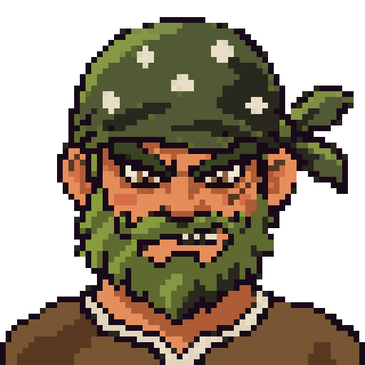

# img-to-pixel

Plugin para **Claude Code** e **Codex** que transforma uma imagem de referência em **pixel art 64×64**, com a sua aprovação em cada etapa. No fim ele exporta **HTML, PNG e SVG, com e sem fundo**.

*Claude Code / Codex plugin: reference image → approved description → 64×64 pixel art → HTML/PNG/SVG, with and without background.*

<p align="center"></p>

## O fluxo

1. **Referência → descrição.** Um modelo leve (Haiku, no Claude) descreve o assunto e você aprova ou edita.
2. **Geração.** O Codex gera 3 variações em paralelo com o melhor modelo de imagem disponível. Elas seguem um prompt de estilo fixo: grid 64×64, contorno escuro, sombreamento em 3 tons e fundo `#FF00FF`. Você pode anexar uma **imagem de estilo**.
3. **Conversão.** O tamanho real do pixel da arte gerada é estimado, e cada pixel é lido pelo centro. O fundo é removido.
4. **Escolha e retoques.** Você escolhe uma variação. Correções finas (olhos, brilhos, dentes) são feitas **direto pelo agente, pixel a pixel**, sem gerar outra imagem, com histórico para desfazer.
5. **Export.** São gerados `pixel_c<tamanho>_g<espaçamento>_{com,sem}_fundo.{html,png,svg}`. No HTML cada pixel é um elemento do grid, e o espaçamento entre pixels é configurável.

- **No Claude Code:** o Claude orquestra e usa o Codex CLI só para gerar a imagem base.
- **No Codex:** o fluxo inteiro roda nele mesmo.

## Requisitos

- Python 3.10+ com `pip install pillow numpy`
- [Codex CLI](https://github.com/openai/codex) logado, com a feature `image_generation` (já vem ativa nas versões recentes)

## Instalação

**Claude Code: pelo marketplace**
```
/plugin marketplace add YuriPereira20/img-to-pixel
/plugin install img-to-pixel@pixel-local
```

**Claude Code: só neste projeto.** Clone o repositório e abra a pasta. O arquivo `.claude/settings.json` já ativa o plugin com escopo de projeto, sem instalar nada globalmente.

**Codex: pelo marketplace**
```bash
codex plugin marketplace add YuriPereira20/img-to-pixel
codex plugin add img-to-pixel@pixel-local
```
A skill aparece como `img-to-pixel:pixel-art`. No Codex o fluxo inteiro roda nele mesmo, inclusive a geração de imagem. Para remover: `codex plugin remove img-to-pixel@pixel-local`.

**Codex: só neste projeto.** Clone o repositório e abra a pasta. A skill também fica em `.agents/skills/pixel-art`.

## Uso

Mande uma imagem e peça algo como *"transforma em pixel art"*, ou use `/pixel-art`. Os arquivos ficam em `output/<nome>/`, e cada rodada fica salva em `vN/`.

Para usar os scripts sem o agente:
```bash
S=plugins/img-to-pixel/scripts
python $S/codex_gen.py output/x/v1 --prompt-file output/x/description.md --style estilo.png --n 3
python $S/pixelize.py preview output/x/v1/generated_1.png output/x      # gera sprite.png 64x64
python $S/pixels.py dump output/x 19 26 46 34 > retoque.txt            # edite as letras do mapa...
python $S/pixels.py apply output/x retoque.txt                         # ...e aplique
python $S/pixelize.py export output/x --cell 8 --gap 1
```

Testes: `python $S/pixelize.py selftest` e `python $S/pixels.py selftest`.

## Observações

- O modelo padrão do Codex é `gpt-6-astra`. Para usar outro, passe `--model`.
- O fundo é removido pela cor `#FF00FF`. Se o personagem usar magenta, esses pixels também somem.
- O tamanho do grid pode ser mudado com `pixelize.py preview --grid 128`.

## Licença

MIT
